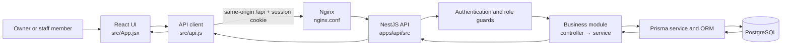

# Project structure and workflow architecture

This project uses a **modular monolith**: one React client, one NestJS API, and one PostgreSQL database. The modules are separated by business responsibility, while remaining deployable together.

## Request and data flow

## Repository map

| Path | Responsibility |
|---|---|
| [`src/App.jsx`](../src/App.jsx) | React screens, navigation, workflow forms, client-side alerts, and page composition |
| [`src/api.js`](../src/api.js) | Same-origin API requests, cookie-session marker, and API response normalization |
| [`apps/api/src/main.ts`](../apps/api/src/main.ts) | NestJS bootstrap, `/api` prefix, Helmet, and DTO validation |
| [`apps/api/src/app.module.ts`](../apps/api/src/app.module.ts) | Composition root that registers the domain modules |
| [`apps/api/src/auth/`](../apps/api/src/auth/) | Login/session authentication, JWT guard, roles decorator, and authorization guard |
| [`apps/api/src/products/`](../apps/api/src/products/) | Product catalog, opening balances, edits, and archive rules |
| [`apps/api/src/movements/`](../apps/api/src/movements/) | Append-only inventory ledger, outbound validation, transfers, physical counts, and approved adjustments |
| [`apps/api/src/purchasing/`](../apps/api/src/purchasing/) | Supplier records, quote comparison and price snapshots, purchase orders, amount-bearing new invoices/returns, partial receipts, and linked damaged-goods movements |
| [`apps/api/src/production/`](../apps/api/src/production/) | Batch growth stages, assigned nursery tasks, care and loss history, and verified ready-to-stock conversion |
| [`apps/api/src/sales/`](../apps/api/src/sales/) | Sales, customer lookup/balances, and transactional stock-out |
| [`apps/api/src/accounting/`](../apps/api/src/accounting/) | Expense approval/payment, supplier payments, cash reconciliation, VAT-rate setup, and operational financial reports |
| [`apps/api/src/dashboard/`](../apps/api/src/dashboard/) | Server-side summary metrics for the dashboard |
| [`apps/api/src/common/stock.ts`](../apps/api/src/common/stock.ts) | Shared ledger-to-stock and per-location balance calculations |
| [`apps/api/src/prisma/`](../apps/api/src/prisma/) | Database connection service shared by modules |
| [`apps/api/prisma/schema.prisma`](../apps/api/prisma/schema.prisma) | PostgreSQL entities, relationships, and enums |
| [`apps/api/prisma/migrations/`](../apps/api/prisma/migrations/) | Versioned schema changes applied by Prisma Migrate |
| [`compose.yaml`](../compose.yaml) | Docker services, networks, health checks, seed profile, and database volume |

## How to read a scenario diagram

Each workflow test includes a node-and-connector Mermaid flowchart and **Project touchpoints** table:

1. **Frontend** — the user, React page/form, and API client.
2. **Backend** — authentication/role guards, controller, and domain service.
3. **Data** — relevant PostgreSQL models and shared stock calculations.
4. **Result** — the returned quantity/status, rejection path, or UI-only behavior.

Inventory quantity is derived from `InventoryMovement` records. Physical counts are immutable snapshots of the ledger balance and counted quantity; they do not directly update inventory. A discrepancy creates a manager-reviewed request, and the approval is rejected if stock changed since the count. Purchase receipts record actual quantities transactionally, with damaged units written as linked losses. The UI then reloads the relevant workspace data.

The flowcharts use color-coded nodes to distinguish frontend, backend, persistence, and result. Their left-to-right layout is intended to make the architecture and branch/validation paths legible in Markdown previews that support Mermaid.

## Module boundaries

- `AppModule` composes the modules; domain services should not be collapsed into a single global workflow service.
- Controllers handle HTTP routes and role restrictions; services handle business rules and database transactions.
- `common/stock.ts` is shared domain support for calculating stock from the movement ledger.
- Prisma schema/migrations define durable data structures; UI labels and display state are not the source of truth for inventory.
- Dashboard alerts and report presentation are partly computed/rendered in the frontend. A UI card is not automatically a server-side report or downloadable export.

See the [workflow test report](testing/stock-workflows/README.md) for what was exercised and the known demo-only behavior.
