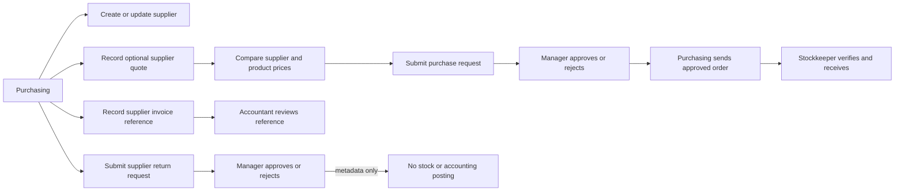

# 01 — Supplier quotes, orders, and document tracking

**Scenario status:** API regression coverage added; execute only against a disposable migrated database.

## Purpose

Verify supplier lifecycle controls, optional supplier quotations and price snapshots, manager approval of purchase orders and returns, stockkeeper-only receiving, and metadata-only supplier invoice tracking.

## Agreed behavior

- Purchasing may create an order with or without a quotation.
- A selected quote line must belong to the same supplier and product as the purchase-order line and must not be expired at submission.
- The order line retains its quoted unit price; without a selected quote, it snapshots the product's current purchase price.
- A manager other than the requester approves or rejects the purchase order. Purchasing can send an approved order; only the manager or stockkeeper can receive it.
- Supplier invoices are references and review statuses only. They do not record amounts, payments, or accounting entries.
- Supplier returns are quantity- and reason-bearing requests requiring manager approval. Approval does not post an inventory movement or accounting entry.
- Supplier records are archived rather than deleted, preserving historical order and document references.
- Purchasing can review products at or below minimum stock and export the currently loaded purchase records as CSV.

## Workflow

## Coverage

The API smoke test covers role rejection, supplier create/update/archive, quote persistence, selected-price snapshots, mismatched and expired quote rejection, invoice duplicate and supplier/order validation, accountant invoice review, return approval/rejection, unchanged stock after return approval, and audit events. The Playwright workflow test stubs all API responses and exercises supplier creation, quote selection on a purchase order, invoice recording, and supplier-return submission.

Mutating API tests require a fresh, disposable, migrated, seeded database. Never run them against a VPS or an operator's business database.

## Exclusions

This phase does not manage quote attachments, quotation acceptance outside the purchase-order workflow, invoice amounts, due dates, payments, supplier balances, VAT, or stock/accounting postings for approved supplier returns. Those require the separately scoped accounting or stock-return workflows.
