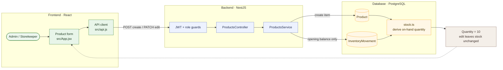

# 01 — Create a product with opening stock, then edit it

**Result: PASS** · Executed 2026-11-02  
**Verification:** Authenticated API integration check against PostgreSQL

## Purpose

Confirm that a newly created catalog item has its opening balance recorded in the stock ledger, and that changing descriptive/pricing fields does not overwrite that balance.

## Project flow

## Project touchpoints

| Layer | Location | Responsibility in this test |
|---|---|---|
| UI | [`src/App.jsx`](../../../src/App.jsx) | Product form and save handler |
| API client | [`src/api.js`](../../../src/api.js) | Sends JSON requests and normalizes product fields |
| Route / rules | [`products.controller.ts`](../../../apps/api/src/products/products.controller.ts), [`products.service.ts`](../../../apps/api/src/products/products.service.ts) | Create/edit authorization and product rules |
| Data model | [`schema.prisma`](../../../apps/api/prisma/schema.prisma) | `Product`, `Category`, and `InventoryMovement` relations |
| Stock math | [`stock.ts`](../../../apps/api/src/common/stock.ts) | Computes quantity from movement ledger entries |

## Preconditions and test data

- Sign in with an Admin account.
- Use an existing category from the category lookup.
- Use a unique SKU/name to avoid conflicting with seeded products.
- Test values: size `1L`, purchase price `2.500 TND`, sale price `5.000 TND`, minimum `5`, location `مشتل 1`, opening quantity `10`.

## Workflow

1. Open **Products → Add product**.
2. Fill the required name, category, size, unit, prices, minimum stock, and location.
3. Enter `10` as the opening quantity and save.
4. Read the new product from the catalog and record its current quantity.
5. Edit the sale price to `5.500 TND` and update its minimum stock.
6. Read the item again.

## Expected results

- Product creation succeeds and the API returns the new item.
- Opening stock is represented as an inbound movement, not an independent editable quantity.
- Product quantity is `10` before and after the edit.
- The changed price/minimum values are returned by the product read.

## Actual result

The product was created and returned with **10 units**. Sale price/minimum edits were reflected, and the ledger-derived quantity remained **10**. **PASS.**

## Cleanup and notes

This test product was reused as the primary product in scenarios 02–07 and 09–10, then reduced to zero and archived. Its movement history remains for auditability.
