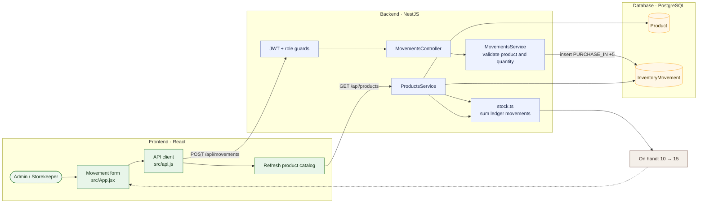

# 02 — Record incoming stock directly

**Result: PASS** · Executed 2026-11-02  
**Verification:** Authenticated API integration check against PostgreSQL

## Purpose

Verify that an ordinary inbound purchase movement increases stock and appears in the movement ledger.

## Project flow

## Project touchpoints

| Layer | Location | Responsibility in this test |
|---|---|---|
| UI | [`src/App.jsx`](../../../src/App.jsx) | Movement form and `addMovement` request body |
| API client | [`src/api.js`](../../../src/api.js) | Sends movement and refresh requests |
| Route / rules | [`movements.controller.ts`](../../../apps/api/src/movements/movements.controller.ts), [`movements.service.ts`](../../../apps/api/src/movements/movements.service.ts) | Role checks, product validation, and movement creation |
| Data model | [`schema.prisma`](../../../apps/api/prisma/schema.prisma) | `InventoryMovement` row linked to `Product` |
| Stock math | [`stock.ts`](../../../apps/api/src/common/stock.ts) | `PURCHASE_IN` contributes positively to product/location balance |

## Preconditions and test data

- Sign in with an Admin account.
- Use the active test product from scenario 01, currently at **10 units** in `مشتل 1`.
- Movement: `PURCHASE_IN`, quantity `5`, destination `مشتل 1`, reason `Scenario test receipt`.

## Workflow

1. Open **Stock Movements → New movement**.
2. Select the test product and **Purchase IN**.
3. Enter quantity `5`, date, destination location, and an optional reason/reference.
4. Save the movement.
5. Re-read the product quantity and the movement history.

## Expected results

- The request succeeds and records an inbound movement.
- Quantity increases exactly by the movement quantity: `10 + 5 = 15`.
- Movement history identifies the product, type, quantity, and destination.

## Actual result

The authenticated API accepted `PURCHASE_IN`; product quantity increased from **10 to 15**. **PASS.**

## Notes

Stock is derived from the append-only movement ledger. The product quantity is not directly overwritten by this operation.
