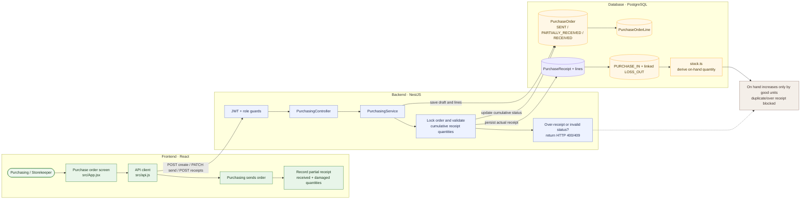

# 03 — Create, send, and receive a supplier order

**Current scope:** Partial receipts and damaged-goods recording (Phase 4)

**Historical baseline:** Full-quantity receipt passed on 2026-11-02; the current flow adds per-receipt evidence.

## Purpose

Verify that actual deliveries are recorded against sent orders, damaged units are linked to losses, partial orders remain open, and cumulative receipts cannot exceed ordered quantities.

## Project flow

## Project touchpoints

| Layer | Location | Responsibility in this test |
|---|---|---|
| UI | [`src/App.jsx`](../../../src/App.jsx) | Purchase-order form and per-line receipt form |
| Route / rules | [`purchasing.controller.ts`](../../../apps/api/src/purchasing/purchasing.controller.ts), [`purchasing.service.ts`](../../../apps/api/src/purchasing/purchasing.service.ts) | Role-gated receipt validation and atomic ledger posting |
| Data model | [`schema.prisma`](../../../apps/api/prisma/schema.prisma) | `PurchaseReceipt`, receipt lines, order status, and linked `InventoryMovement` |
| Stock math | [`stock.ts`](../../../apps/api/src/common/stock.ts) | Receipt movements increase product/location balance |

## Preconditions and test data

- Sign in with a Storekeeper account.
- Prepare an order using an active seeded supplier and the active test product; have a manager approve it and Purchasing send it.
- Product quantity before receipt: **15**.
- Sent order line: **4 units** of the test product.

## Workflow

1. As Purchasing, create a purchase order with the test product and quantity `4`.
2. Have the manager approve it, then have Purchasing send it.
3. As Storekeeper, record an initial delivery of `2` units, including `1` damaged unit.
4. Confirm the order is `PARTIALLY_RECEIVED`; only one good unit has been added to stock.
5. Receive the remaining `2` units and confirm the order becomes `RECEIVED`.
6. Attempt an over-receipt and a further receipt after completion.

## Expected results

- Order status transitions from `SENT` to `PARTIALLY_RECEIVED` to `RECEIVED`.
- Each receipt writes an inbound movement for the full arrived quantity; damaged units write a linked `LOSS_OUT`.
- Stock changes from `15` to `18` in this example (four delivered, one damaged).
- Over-receipt and post-completion receipt attempts are rejected without extra ledger entries.

## Actual result

The automated API and UI regression cases cover partial receipt, damaged quantity, cumulative over-receipt rejection, and receipt role restrictions. Run the API suite only against the documented disposable test database; it was not run against live/VPS data for this phase.

## Notes

Receipt data, ledger movements, and order status are committed together. Existing fully received orders remain historical records; receipt editing/deletion and direct movement editing/deletion are prohibited.
