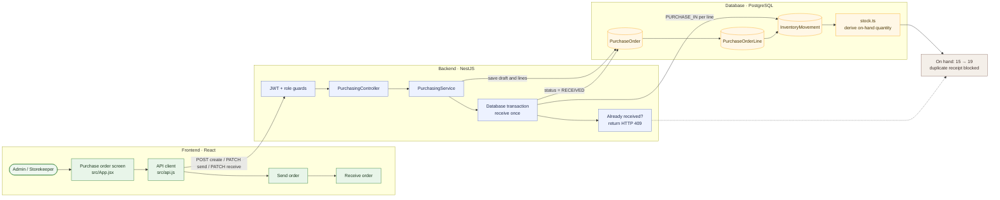

# 03 — Create, send, and receive a supplier order

**Result: PASS** · Executed 2026-11-02  
**Verification:** Authenticated API integration check against PostgreSQL

## Purpose

Verify the purchase-order lifecycle and that receiving adds inventory exactly once.

## Project flow

## Project touchpoints

| Layer | Location | Responsibility in this test |
|---|---|---|
| UI | [`src/App.jsx`](../../../src/App.jsx) | Purchase-order form, send and receive actions |
| Route / rules | [`purchasing.controller.ts`](../../../apps/api/src/purchasing/purchasing.controller.ts), [`purchasing.service.ts`](../../../apps/api/src/purchasing/purchasing.service.ts) | Draft lifecycle and transactional receiving |
| Data model | [`schema.prisma`](../../../apps/api/prisma/schema.prisma) | `PurchaseOrder`, `PurchaseOrderLine`, and linked `InventoryMovement` |
| Stock math | [`stock.ts`](../../../apps/api/src/common/stock.ts) | Receipt movements increase product/location balance |

## Preconditions and test data

- Sign in with an Admin account.
- Select an active seeded supplier and the active test product.
- Product quantity before receipt: **15**.
- Create an order with one line: **4 units** of the test product.

## Workflow

1. Open **Purchases** and create an order for the selected supplier.
2. Add the test product and quantity `4`; save as a draft.
3. Send the purchase order.
4. Receive the order.
5. Refresh the product catalog and verify the quantity.
6. Attempt to receive the same order again.

## Expected results

- Order status transitions from `DRAFT` to `SENT` to `RECEIVED`.
- The receiving operation writes an inbound movement linked to the order line.
- Stock changes from `15` to `19`.
- Repeated receipt is rejected and creates no second inbound movement.

## Actual result

The order moved through all three statuses. Stock increased from **15 to 19**. The second receive attempt returned **HTTP 409 Conflict** and did not increase stock again. **PASS.**

## Notes

The order record and its inventory movements are written transactionally. A received order is not eligible for another receipt.
