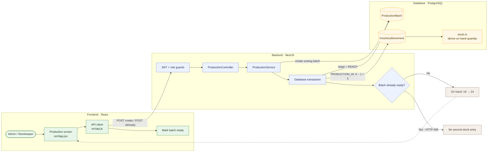

# 04 — Convert a production batch into sale-ready stock

**Result: PASS** · Executed 2026-11-02  
**Verification:** Authenticated API integration check against PostgreSQL

## Purpose

Verify that marking a batch ready posts only its surviving seedlings as a production-in movement, and that the transition is one-time.

## Project flow

## Project touchpoints

| Layer | Location | Responsibility in this test |
|---|---|---|
| UI | [`src/App.jsx`](../../../src/App.jsx) | Batch form and ready action |
| Route / rules | [`production.controller.ts`](../../../apps/api/src/production/production.controller.ts), [`production.service.ts`](../../../apps/api/src/production/production.service.ts) | Batch validation and one-time ready transaction |
| Data model | [`schema.prisma`](../../../apps/api/prisma/schema.prisma) | `ProductionBatch` and `InventoryMovement` |
| Stock math | [`stock.ts`](../../../apps/api/src/common/stock.ts) | `PRODUCTION_IN` is included in inventory balance |

## Preconditions and test data

- Sign in with an Admin account.
- Use the active test product at **19 units** and an active product lookup.
- Batch values: quantity sown `6`, quantity lost `1`, stage `SOWING`, expected ready date in the future.
- Expected ready quantity: `6 - 1 = 5`.

## Workflow

1. Open **Production** and create a batch linked to the test product.
2. Enter the seed type, sowing date, quantity sown, loss count, and expected-ready date.
3. Mark the batch **Ready**.
4. Read product quantity and movement history.
5. Attempt to mark the same batch ready again.

## Expected results

- Batch transitions to `READY`.
- A `PRODUCTION_IN` movement adds exactly 5 units.
- Quantity changes from `19` to `24`.
- A repeated ready transition is rejected without adding stock.

## Actual result

The ready action posted **5 plants**, taking stock from **19 to 24**. A repeated transition returned **HTTP 409 Conflict**. **PASS.**

## Notes

Ready conversion and its inventory movement are performed in one transaction. The batch cannot be edited or posted again after becoming ready.
