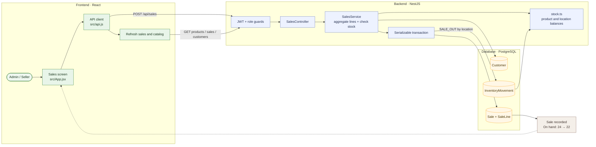

# 05 — Record a paid customer sale

**Result: PASS** · Executed 2026-11-02  
**Verification:** Authenticated API integration check against PostgreSQL

## Purpose

Verify that sale creation validates available stock and writes the sale and sale-out movement together.

## Project flow

## Project touchpoints

| Layer | Location | Responsibility in this test |
|---|---|---|
| UI | [`src/App.jsx`](../../../src/App.jsx) | Sale form, quantity precheck, and submit handler |
| Route / rules | [`sales.controller.ts`](../../../apps/api/src/sales/sales.controller.ts), [`sales.service.ts`](../../../apps/api/src/sales/sales.service.ts) | Role enforcement, stock validation, transactional sale |
| Data model | [`schema.prisma`](../../../apps/api/prisma/schema.prisma) | `Sale`, `SaleLine`, `Customer`, and linked movements |
| Stock math | [`stock.ts`](../../../apps/api/src/common/stock.ts) | Validates total balance and finds location balances |

## Preconditions and test data

- Sign in with an Admin account (the Seller role is also authorized to create sales).
- Select an active seeded customer.
- Use the active test product at **24 units**.
- Sale line: quantity `2`; payment status `PAID`.

## Workflow

1. Open **Sales → New sale**.
2. Select the customer.
3. Add the test product with quantity `2`.
4. Select **Paid** and confirm the sale.
5. Check the created sale and reload the product catalog.

## Expected results

- Sale is created with the selected customer, line quantity, price, and payment status.
- A `SALE_OUT` movement is created and linked to the sale line.
- Quantity changes from `24` to `22`.

## Actual result

A paid sale was created successfully. Product stock decreased from **24 to 22**, and the sale and inventory movement were persisted together. **PASS.**

## Notes

Credit sales can be selected as well, but this scenario covers the paid path. Payment collection/settlement is not implemented in the demo.
