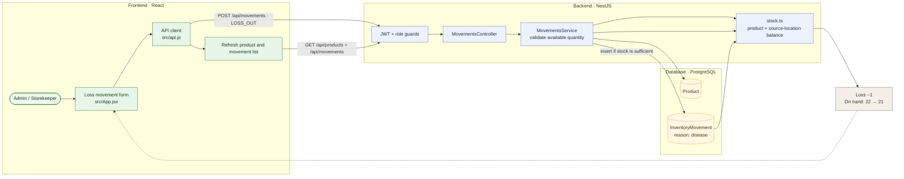

# 06 — Record a plant loss or mortality

**Result: PASS** · Executed 2026-11-02  
**Verification:** Authenticated API integration check against PostgreSQL

## Purpose

Verify that a loss movement records the reason and reduces on-hand inventory.

## Project flow

## Project touchpoints

| Layer | Location | Responsibility in this test |
|---|---|---|
| UI | [`src/App.jsx`](../../../src/App.jsx) | Loss reason selector and movement submission |
| Route / rules | [`movements.controller.ts`](../../../apps/api/src/movements/movements.controller.ts), [`movements.service.ts`](../../../apps/api/src/movements/movements.service.ts) | Validates stock before inserting outbound movement |
| Data model | [`schema.prisma`](../../../apps/api/prisma/schema.prisma) | `InventoryMovement` stores type, reason, user, and location |
| Stock math | [`stock.ts`](../../../apps/api/src/common/stock.ts) | `LOSS_OUT` subtracts from product and source-location stock |

## Preconditions and test data

- Sign in with an Admin or Storekeeper account.
- Use the active test product at **22 units** in `مشتل 1`.
- Movement values: type `LOSS_OUT`, quantity `1`, reason `disease`.

## Workflow

1. Open **Stock Movements → New movement**.
2. Select the test product and **Loss OUT**.
3. Enter quantity `1`, select the source location, and choose a reason such as disease, frost, drought, or damage.
4. Save the movement.
5. Check product quantity and movement history.

## Expected results

- Request is accepted while available stock is sufficient at the selected location.
- A loss movement contains the selected reason and location.
- Quantity changes from `22` to `21`.

## Actual result

The disease-related loss was accepted. Stock decreased from **22 to 21**, and the movement was available in history. **PASS.**

## Notes

Loss reason is movement metadata; it does not change how much the ledger subtracts. The same outbound guard applies to all loss movements.
