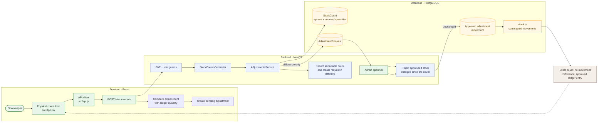

# 07 — Count stock and request an approved adjustment

**Scenario status:** Phase 4 API regression coverage added; execute only against a disposable migrated database.

## Purpose

Verify that stockkeepers record a physical count, the server captures the ledger balance for the location, and only a manager-approved discrepancy changes stock.

## Project flow

## Project touchpoints

| Layer | Location | Responsibility in this test |
|---|---|---|
| UI | [`src/App.jsx`](../../../src/App.jsx) | Physical count form and manager review actions |
| Route / rules | [`adjustments.controller.ts`](../../../apps/api/src/movements/adjustments.controller.ts), [`adjustments.service.ts`](../../../apps/api/src/movements/adjustments.service.ts) | Count capture, discrepancy request, stale-count rejection, and approval |
| Data model | [`schema.prisma`](../../../apps/api/prisma/schema.prisma) | Immutable `StockCount`, linked `AdjustmentRequest`, and ledger movements |
| Stock math | [`stock.ts`](../../../apps/api/src/common/stock.ts) | Per-location balances and signed ledger calculations |

## Preconditions and test data

- Sign in as a Storekeeper and select an active test product at a known location.
- Submit an exact count and confirm that it creates history but no adjustment request.
- Submit a discrepant count and confirm stock does not change until an Admin approves it.

## Workflow

1. Open **Stock Movements → Physical count** and enter the product, location, counted quantity, and reason.
2. Verify the count stores both the system and counted quantities.
3. If they differ, verify a pending adjustment request is linked to the count and stock is unchanged.
4. Approve as a different Admin user and verify one reasoned movement is posted.
5. Change stock after another count and verify its stale adjustment cannot be approved.

## Expected results

- Exact counts are retained as immutable evidence and do not post movements.
- A discrepancy creates a manager-reviewed request linked to its count.
- Approval is rejected if the ledger balance at that location changed since the count.
- Approved adjustments create append-only inbound or outbound ledger movements.

## Automated coverage

Focused API regression coverage verifies exact counts, both discrepancy directions, approval/rejection, unchanged stock while pending, stale-count rejection, role restrictions, and audit events. The mutation-enabled API suite must run only on a disposable migrated database.

## Notes

Stockkeepers cannot submit arbitrary adjustment quantities or write adjustment movements directly. They report the physical count; the server computes the difference, and the manager approves or rejects the resulting request.
