# 07 — Correct a stock count with adjustments

**Result: PASS** · Executed 2026-11-02  
**Verification:** Authenticated API integration check against PostgreSQL

## Purpose

Verify positive and negative inventory corrections are kept as separate ledger entries and net correctly.

## Project flow

```mermaid
flowchart LR
    subgraph FRONTEND["Frontend · React"]
        USER([Admin / Storekeeper]) --> FORM["Adjustment form<br/>src/App.jsx"]
        FORM --> CLIENT["API client<br/>src/api.js"]
        CLIENT --> IN["Increase +3"]
        CLIENT --> OUT["Decrease −2"]
    end
    subgraph BACKEND["Backend · NestJS"]
        GUARD["JWT + role guards"] --> CTRL["MovementsController"]
        CTRL --> SERVICE["MovementsService"]
        SERVICE --> VALIDATE["Check available stock<br/>for outbound only"]
    end
    subgraph DATA["Database · PostgreSQL"]
        INROW[(ADJUSTMENT_IN)]
        OUTROW[(ADJUSTMENT_OUT)]
        STOCK["stock.ts<br/>sum signed movements"]
    end
    IN -->|"POST /api/movements"| GUARD
    OUT -->|"POST /api/movements"| GUARD
    SERVICE --> INROW
    SERVICE --> VALIDATE
    VALIDATE --> OUTROW
    INROW --> STOCK
    OUTROW --> STOCK
    STOCK --> RESULT["Net +1<br/>On hand: 21 → 22"]
    RESULT -.-> FORM
    classDef actor fill:#eef7ef,stroke:#2e7d32,color:#18351b
    classDef ui fill:#e8f5e9,stroke:#2e7d32,color:#18351b
    classDef api fill:#edf2ff,stroke:#6475bd,color:#202b4a
    classDef data fill:#fff7e6,stroke:#f9a825,color:#493500
    classDef result fill:#f4efe9,stroke:#8d6e63,color:#3d302b
    class USER actor
    class FORM,CLIENT,IN,OUT ui
    class GUARD,CTRL,SERVICE,VALIDATE api
    class INROW,OUTROW,STOCK data
    class RESULT result
```

## Project touchpoints

| Layer | Location | Responsibility in this test |
|---|---|---|
| UI | [`src/App.jsx`](../../../src/App.jsx) | Adjustment direction selector maps to inbound/outbound enum |
| Route / rules | [`movements.controller.ts`](../../../apps/api/src/movements/movements.controller.ts), [`movements.service.ts`](../../../apps/api/src/movements/movements.service.ts) | Direction handling and availability validation |
| Data model | [`schema.prisma`](../../../apps/api/prisma/schema.prisma) | Separate `ADJUSTMENT_IN` and `ADJUSTMENT_OUT` ledger rows |
| Stock math | [`stock.ts`](../../../apps/api/src/common/stock.ts) | Inbound adjustment adds; outbound adjustment subtracts |

## Preconditions and test data

- Sign in with an Admin or Storekeeper account.
- Use the active test product at **21 units**.
- Apply `ADJUSTMENT_IN +3`, then `ADJUSTMENT_OUT -2`.
- Provide a reason/reference that explains the physical count correction.

## Workflow

1. Open **Stock Movements → New movement → Adjustment**.
2. Choose **Increase stock** and enter `3`; select destination location and save.
3. Create another adjustment; choose **Decrease stock** and enter `2`; select source location and save.
4. Re-read the product quantity and the two movements.

## Expected results

- Both corrections are persisted as distinct movements with their respective directions.
- Net change is `+3 - 2 = +1`.
- Quantity changes from `21` to `22`.

## Actual result

Both adjustments were accepted; the quantity changed from **21 to 22**. **PASS.**

## Notes

An adjustment is not an edit to a stored quantity: it adds a correction entry to the inventory ledger. Decreases remain subject to stock availability checks.
