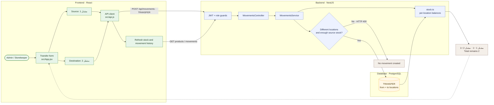

# 08 — Transfer stock between locations

**Result: PASS** · Executed 2026-11-02  
**Verification:** Browser UI submission plus authenticated API and movement-history checks

## Purpose

Verify a transfer moves stock between two locations without changing the product's total on-hand quantity.

## Project flow

## Project touchpoints

| Layer | Location | Responsibility in this test |
|---|---|---|
| UI | [`src/App.jsx`](../../../src/App.jsx) | Transfer-only source and destination selectors |
| Client | [`src/api.js`](../../../src/api.js) | Sends the transfer body and refreshes the workspace |
| Route / rules | [`movements.controller.ts`](../../../apps/api/src/movements/movements.controller.ts), [`movements.service.ts`](../../../apps/api/src/movements/movements.service.ts) | Enforces different locations and available source stock |
| Data model | [`schema.prisma`](../../../apps/api/prisma/schema.prisma) | `TRANSFER` movement stores both location fields |
| Stock math | [`stock.ts`](../../../apps/api/src/common/stock.ts) | Removes quantity from source and adds it to destination |

## Preconditions and test data

- Sign in with an Admin or Storekeeper account.
- Use an active test product with **2 units** at source `مشتل 1`.
- Transfer quantity: `1`; destination: `مشتل 2`.
- Source and destination must be different, and the source must have enough stock.

## Workflow

1. Open **Stock Movements → New movement**.
2. Select the test product and movement type **Transfer**.
3. Enter quantity `1`.
4. Select **From location** `مشتل 1` and **To location** `مشتل 2`.
5. Submit in the browser.
6. Check movement history and product quantity.

## Expected results

- UI submits both locations to the API.
- Transfer movement stores source `مشتل 1` and destination `مشتل 2`.
- Source balance falls by 1, destination balance rises by 1.
- Total stock remains `2`.

## Actual result

The browser form submitted successfully. API/history verification found both the source and destination; the history displayed the destination and quantity. Total stock remained **2**. **PASS.**

## Fix made during testing

The transfer form did not reliably submit a destination. It now presents separate required source and destination fields and sends both values to the API.
