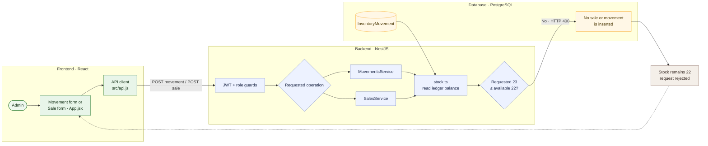

# 09 — Reject stock-out greater than available quantity

**Result: PASS** · Executed 2026-11-02  
**Verification:** Authenticated API integration check against PostgreSQL

## Purpose

Confirm that neither manual outbound movements nor sales can consume more inventory than is available.

## Project flow

## Project touchpoints

| Layer | Location | Responsibility in this test |
|---|---|---|
| UI | [`src/App.jsx`](../../../src/App.jsx) | Sale precheck and movement form; backend remains authoritative |
| Movement route | [`movements.service.ts`](../../../apps/api/src/movements/movements.service.ts) | Validates product and source stock for outbound movement |
| Sales route | [`sales.service.ts`](../../../apps/api/src/sales/sales.service.ts) | Aggregates duplicate product lines and validates total available stock |
| Stock math | [`stock.ts`](../../../apps/api/src/common/stock.ts) | Computes total and location-specific balances |
| Persistence | [`schema.prisma`](../../../apps/api/prisma/schema.prisma) | Rejected operation creates no movement/sale rows |

## Preconditions and test data

- Sign in with an Admin account.
- Use the active test product at **22 units**.
- Request quantity: `23` for both a loss movement and a sale.
- Use an active seeded customer for the sale request.

## Workflow

1. Submit a `LOSS_OUT` movement for quantity `23`.
2. Submit a paid sale for quantity `23` of the same product.
3. Read the product quantity and sale history after both requests.

## Expected results

- Each request is rejected with a client error indicating insufficient stock.
- Neither rejected request decreases the balance.
- Rejected sale does not produce a completed sale record.

## Actual result

Both requests returned **HTTP 400 Bad Request**. Product quantity remained **22**. **PASS.**

## Notes

The check also verifies that duplicate sale lines cannot bypass the stock check: the sale service aggregates requested quantities by product before validating availability.
