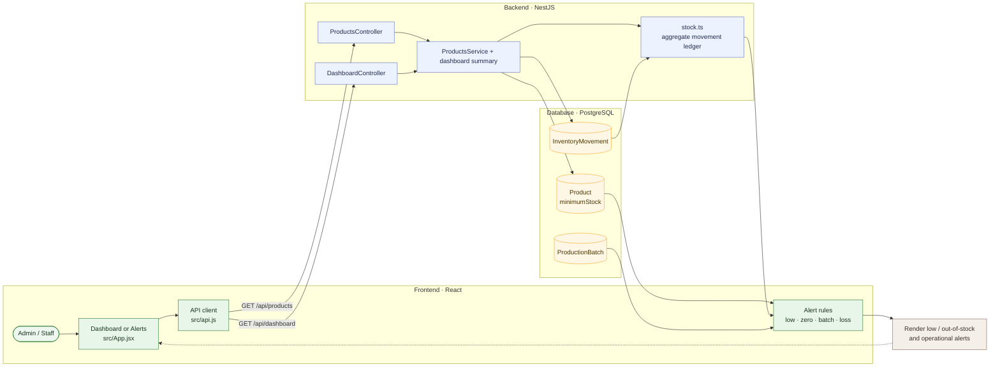

# 10 — Verify low-stock and out-of-stock alerts

**Result: PASS** · Executed 2026-11-02  
**Verification:** Dashboard API metrics and Arabic browser Alerts screen

## Purpose

Verify alert behavior at the configured minimum-stock threshold and at zero stock.

## Project flow

## Project touchpoints

| Layer | Location | Responsibility in this test |
|---|---|---|
| UI | [`src/App.jsx`](../../../src/App.jsx) | Derives alert cards from current products, movements, batches, and loss totals |
| API reads | [`products.controller.ts`](../../../apps/api/src/products/products.controller.ts), [`dashboard.module.ts`](../../../apps/api/src/dashboard/dashboard.module.ts) | Returns product quantities and dashboard summary |
| Data model | [`schema.prisma`](../../../apps/api/prisma/schema.prisma) | Product minimum stock and movement records |
| Stock math | [`stock.ts`](../../../apps/api/src/common/stock.ts) | Aggregates the ledger to get on-hand quantities |

## Preconditions and test data

- Sign in as Admin.
- Use a dedicated test item with minimum stock `5` for the dashboard threshold check.
- For the browser low-stock check, use a test item with quantity `2` and minimum `3`.
- For the out-of-stock check, deplete that item's final units through valid loss movements.

## Workflow

1. Read the dashboard low-stock count.
2. Set the first test product's minimum to `5` and bring its quantity to exactly `5`.
3. Read the dashboard summary again.
4. In a separate browser check, set another test product to quantity `2`, minimum `3`; open **Alerts** and verify its name and threshold details.
5. Reduce that test product to `0`, refresh the browser, and revisit **Alerts**.

## Expected results

- A product at or below minimum stock contributes to the low-stock count.
- Alerts identifies a positive-but-low product with its current and minimum quantities.
- At quantity zero, Alerts identifies it as out of stock.

## Actual result

At quantity **5**, the dashboard low-stock count increased by one. Browser UI showed **المتاح 2 فقط · الحد الأدنى 3** for a low-stock test product. At quantity **0**, Alerts showed **نفد المخزون: منتج تحويل MVZFMPVY**. **PASS.**

## Cleanup and related scenarios

Temporary test items were archived after use. Restocking behavior is covered in [scenario 02](02-direct-stock-in.md) and [scenario 03](03-purchase-order-receipt.md).
