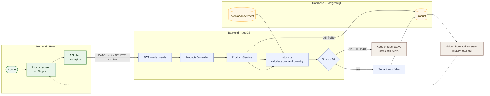

# 11 — Edit and archive a product safely

**Result: PASS** · Executed 2026-11-02  
**Verification:** Authenticated API integration check against PostgreSQL

## Purpose

Verify product edits persist, an Admin cannot archive an item with stock, and a zero-stock item can be soft-archived.

## Project flow

## Project touchpoints

| Layer | Location | Responsibility in this test |
|---|---|---|
| UI | [`src/App.jsx`](../../../src/App.jsx) | Edit form and confirmation before archive |
| Route / roles | [`products.controller.ts`](../../../apps/api/src/products/products.controller.ts) | Admin-only archive and Admin/Storekeeper edit routes |
| Business rules | [`products.service.ts`](../../../apps/api/src/products/products.service.ts) | Refuses archive while ledger stock is positive; soft-archives at zero |
| Data model | [`schema.prisma`](../../../apps/api/prisma/schema.prisma) | `Product.active` keeps archived products and history linked |
| Stock math | [`stock.ts`](../../../apps/api/src/common/stock.ts) | Supplies on-hand quantity for archive guard |

## Preconditions and test data

- Sign in with the Admin role; product archiving is Admin-only.
- Use one active product for the edit check.
- Create a separate active product with **1 unit** for the archive guard check.

## Workflow

1. Edit an active product's localized name or sale price and read it again.
2. Attempt to archive the separate product while its quantity is `1`.
3. Record a valid `LOSS_OUT` of `1` from its stocked location.
4. Retry the archive.
5. Refresh the active product catalog and inspect movement history.

## Expected results

- Product changes persist.
- Archive with positive stock returns a conflict and leaves the product active.
- Archive at zero succeeds and the product is removed from the active catalog.
- Existing movement history is retained (soft archive).

## Actual result

Edits persisted. Archiving with stock returned **HTTP 409 Conflict**. After a one-unit stock-out, archiving returned success and the item disappeared from the active catalog. **PASS.**

## Notes

Archiving does not delete the database row or its related ledger records. It marks the item inactive, preserving references and history.
