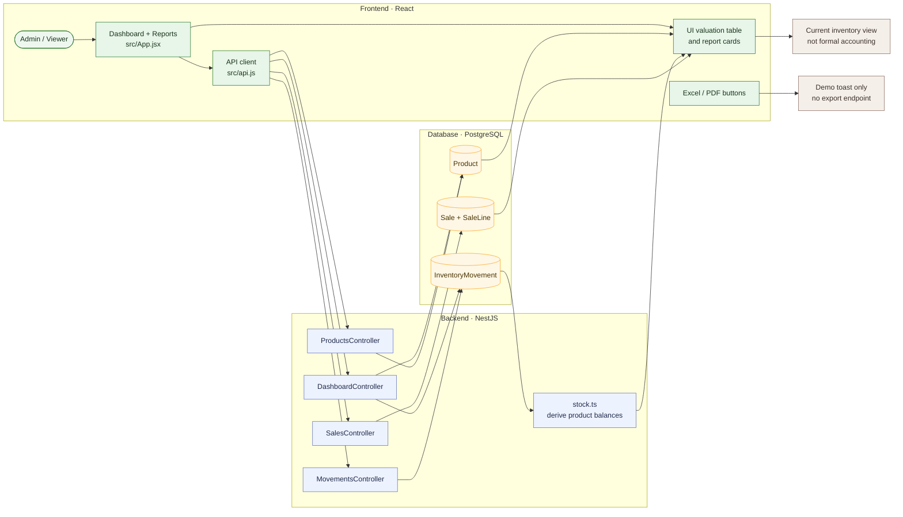

# 12 — Review inventory, movements, and reports

**Result: PASS for viewing; exports have demo limitations** · Executed 2026-11-02  
**Verification:** Authenticated API checks and Arabic browser UI

## Purpose

Confirm that inventory valuation and movement history are available for review, and distinguish implemented report views from presentation-only export controls.

## Project flow

## Project touchpoints

| Layer | Location | Responsibility in this test |
|---|---|---|
| UI | [`src/App.jsx`](../../../src/App.jsx) | Displays valuation/history summaries; export controls are local demo handlers |
| API reads | [`dashboard.module.ts`](../../../apps/api/src/dashboard/dashboard.module.ts), products/movements/sales services | Return persisted summary inputs |
| Data model | [`schema.prisma`](../../../apps/api/prisma/schema.prisma) | Products, movements, sales, and sale lines |
| Stock math | [`stock.ts`](../../../apps/api/src/common/stock.ts) | Converts movements to on-hand quantities |
| Architecture | [`architecture.md`](../../architecture.md) | Explains presentation versus API/data responsibilities |

## Preconditions

- Sign in as Admin.
- Seeded nursery data and scenario-generated test history are available.
- The tested primary product has a sale, loss, purchase, production, adjustment, and transfer history.

## Workflow

1. Read the dashboard summary and verify that stock value and low-stock values are numeric.
2. Open **Stock Movements** and inspect the tested product's movement list.
3. Open **Reports** and review the inventory valuation table and available summary cards.
4. Click **Export Excel**, then **Export PDF**, and observe the response.

## Expected results

- Dashboard summary loads successfully.
- Movement history shows the product's recorded stock operations.
- Reports page presents the current inventory valuation and report summaries.
- Any mock-only export behavior is identified rather than mistaken for a generated report.

## Actual result

The dashboard returned numeric valuation and alert metrics. History contained **13 movements** for the primary test product, including purchase, production, sale, loss, adjustment, and transfer. The browser rendered the inventory valuation table and report cards. Both export buttons displayed demo confirmation toasts. **PASS for viewing.**

## Limitations

- Excel/PDF controls do **not** generate or download files; they only show confirmation messages.
- Seasonal sales and some report summaries contain presentation/demo data and were not reconciled against formal accounting records.
- Do not use these views as official financial statements.
